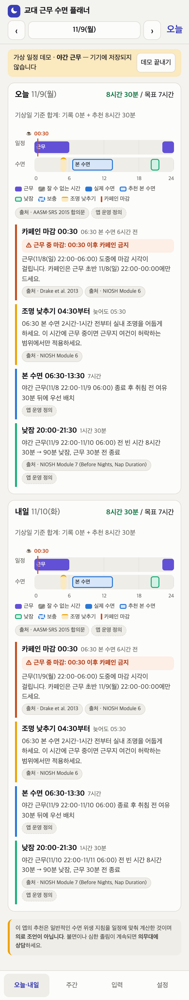

# Shift Sleep Planner

A Korean-language phone web app that turns a night- or rotating-shift roster into sleep, nap, caffeine-cutoff and dim-light times, with every rule tagged by its published source. Schedules stay on the phone.

Built with AI coding agents (Claude, Codex); tests and verification by me.

Not medical advice. The app diagnoses nothing.



Today view for a fictional night shift. Every schedule in the code, tests, demo and screenshots is fictional.

Live demo with a fictional night-shift schedule: https://shift-sleep-planner-theta.vercel.app/?demo=night (the AI summary there is a fixed example sentence).

## Results

| Check | Result | Source |
|---|---|---|
| Fictional 22:00–06:00 night shift | Main sleep 06:30–13:30; a 90-minute nap 20:00–21:30 before the next shift; caffeine cutoff 00:30, flagged because it falls mid-shift | `tests/planner.test.ts` |
| Fictional night-shift week | Logged-days deficit of 3 h 30 min; a 9-hour day does not offset it | `tests/weekView.test.tsx` |
| Free time of 45–49 minutes before a shift | The 20-minute nap is skipped to keep the 30-minute margin, and the app says why | `tests/planner.test.ts` |
| AI-summary payload | Only allowed keys; per-day totals for logged days; no time, date or note from the sample week; mixed-in times are rejected | `tests/aiPayload.test.ts` |
| Serverless function imports | Every relative import reachable from `api/summary.ts` has a `.js` extension | `tests/serverImports.test.ts` |
| Test suite | 64 tests pass | `tests/` |

The import test exists because the first deployment failed with `ERR_MODULE_NOT_FOUND`: Node's native ES modules need explicit file extensions, and the local tests had not caught it.

## How it was verified

- The planner is a set of pure functions, so each rule is tested with fixed fictional rosters: shifts that cross midnight, overlap rejection, nap placement and the 30-minute margin, caffeine-cutoff arithmetic, 24-hour totals and the deficit rule.
- Writing the rules down exposed a conflict in the brief: a 20-minute nap that must end 30 minutes before the shift cannot fit a gap of 45–49 minutes. The app keeps the margin, skips the nap and shows the reason.
- The browser and the server run the same payload validator. Tests check that a sample week produces no time, date or note in the AI payload, and that rate limits and the demo mode behave as specified.
- The AI-summary handler is tested only with a mock model. It has never been run with a real API key.
- On the production deployment, a valid payload gets the labelled example summary and a payload containing a time is rejected with HTTP 400.

## Limits

- Not medical advice. I have not tested whether using the app improves sleep, alertness or safety; the tests show that the rules are applied as written, not that the rules help.
- The rules are simplified readings of the cited guidance. The 24-hour total, the wind-down and wake-up margins and the placement heuristics are my own choices, labelled in the app as app definitions (앱 운영 정의).
- The optional AI summary is switched off in the public demo, which returns a fixed example sentence. A real summary could be wrong.
- The interface is in Korean only.

## Run it

Tested with Node.js 26.

```sh
git clone https://github.com/hyh4867/shift-sleep-planner.git
cd shift-sleep-planner
npm ci
npm test
npm run build
npm run dev
```

`npm run build` type-checks and writes the PWA to `dist/`. The demo schedules open from Settings or with `?demo=day|night|mixed`; demo data is not saved. No data download is needed.

The AI summary is optional. To enable it on your own deployment, set the variables in `.env.example` (an Anthropic API key and an Upstash Redis store for rate limits) as server environment variables. Without them the function does not call a model and returns a fixed summary labelled as a demo example.

## Data, citation and licenses

There is no dataset. Shift and sleep times are stored only in the browser's IndexedDB; backup is a JSON file the user exports.

Rules and their sources:

- Watson et al., Recommended Amount of Sleep for a Healthy Adult: A Joint Consensus Statement of the AASM and SRS, *J Clin Sleep Med* (2015), [doi:10.5664/jcsm.4758](https://doi.org/10.5664/jcsm.4758).
- NIOSH, Training for Nurses on Shift Work and Long Work Hours, Pub. 2015-115, [cdc.gov](https://www.cdc.gov/niosh/publications/hcp/numbered/2015-115.html).
- Drake et al., Caffeine Effects on Sleep Taken 0, 3, or 6 Hours before Going to Bed, *J Clin Sleep Med* (2013), [doi:10.5664/jcsm.3170](https://doi.org/10.5664/jcsm.3170).

Dependencies: React and React DOM (MIT), idb (ISC), Anthropic TypeScript SDK (Apache-2.0); for development, Vite, Vitest, vite-plugin-pwa and @vitejs/plugin-react (MIT), TypeScript and playwright-core (Apache-2.0).

Code: MIT License, see `LICENSE`.
